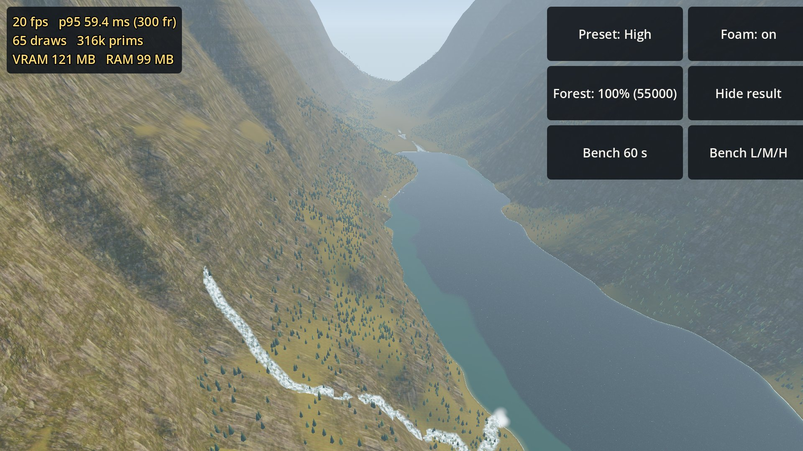
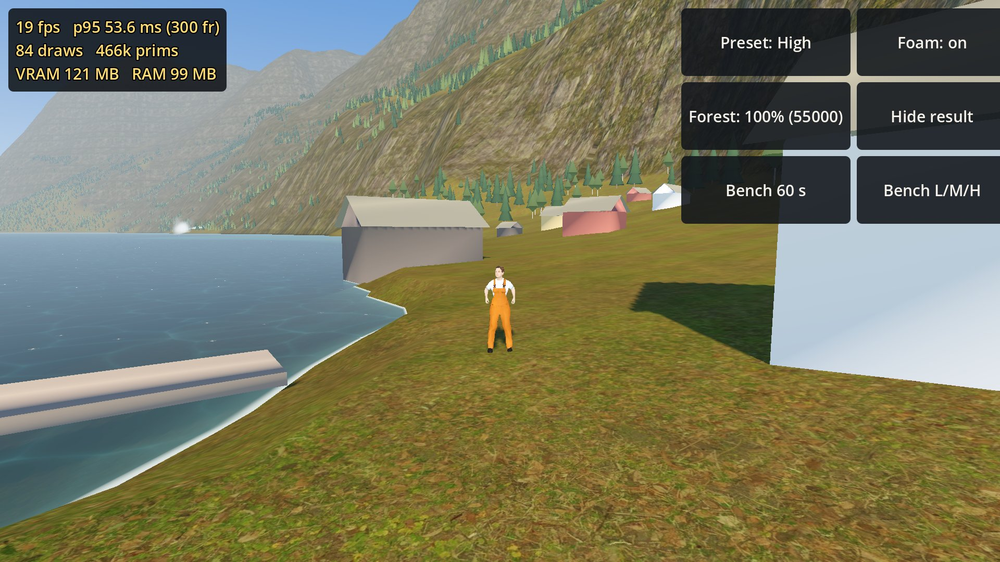

# MWM Wayfarer

**[Download the phone performance spike APK (Android)](https://github.com/Matswm86/mwm-wayfarer/releases/download/latest/mwm-wayfarer.apk)**

Working title. A non-violent open-world game for Android: explore, gather, build, trade and travel between regions that each look different. Engine: Godot 4.6 (Mobile renderer).

## What the APK is right now: a performance spike

The current build is a test scene, not the game. It answers one question: can a phone show the real Naeroyfjord valley at 60 fps (high-end) or 30 fps (floor) with the Mobile renderer? Budgets are in `docs/GDD.md` section 9.4.

What is in it:
- 12.8 x 12.8 km of real terrain (Kartverket 10 m model, 2.5 m round the village), drawn as chunked tiles with five levels of detail.
- Grey rock on steep faces with detail at two scales, darker wet rock at the waterline, grass low, snow only on flatter high ground.
- The fjord water with chart-depth shallows and an optional shore-foam effect.
- Up to 55 000 pines and birches below about 500 m, grass round the player, a waterfall down the gully on the east wall.
- Ingrid, a villager standing idle by the jetty, and a walking explorer you control.

| Spawn, Low preset | Over the fjord | Waterfall gully | Ingrid at the jetty |
|---|---|---|---|
|  |  |  |  |

All screenshots come from the real Godot build (screenshot bot `tests/capture.tscn`, rendered on a laptop GPU). Laptop frame rates say nothing about phones; only the Bench numbers on the phone count.

## Install on a phone or tablet

1. On the device, tap [mwm-wayfarer.apk](https://github.com/Matswm86/mwm-wayfarer/releases/download/latest/mwm-wayfarer.apk) (or open the [latest release](https://github.com/Matswm86/mwm-wayfarer/releases/tag/latest)).
2. Open the file and allow "Install from this source" if Android asks.
3. If an older build will not update (signature mismatch), uninstall it first.

The APK runs on 64-bit phones and 32-bit tablets (arm64-v8a and armeabi-v7a). It is a release build signed with a CI key, for sideloading only. Landscape.

## Controls

- Left side of the screen: put a thumb down and drag to walk; push the stick all the way to run.
- Right side: drag to turn the camera round the player.
- Three-finger tap: hide or show the readout and buttons.

## Readout and buttons

Top left (always on): frames per second, p95 frame time over the last 300 frames, draw calls, primitives, video memory and static memory.

| Button | What it does |
|---|---|
| Preset | Cycles Low / Medium / High (table below). |
| Foam | Switches the depth-buffer shore foam on the water on or off, to compare its cost. |
| Forest | Cycles 35 % / 65 % / 100 % of the trees. |
| Bench 60 s | Flies the camera along a fixed 60 s path over the village and the fjord, then shows average fps, p95 ms, max ms, average and max draw calls and max primitives for the current preset. |
| Bench L/M/H | Runs the same flight for Low, Medium and High in a row (3 minutes) and shows one line per preset. |
| Hide result | Closes the bench result. |

| Preset | Render scale | Sun shadows | Forest | Grass | Shore foam |
|---|---|---|---|---|---|
| Low | 0.70 | off | 35 % | off | off |
| Medium | 0.85 | on (2 splits, 70 m) | 65 % | half | off |
| High | 1.00 | on (2 splits, 70 m) | 100 % | full | on |

To report a phone result: run Bench L/M/H and take a screenshot of the result box.

## Repository

- `docs/BRIEF.md`: the owner brief. `docs/GDD.md`: game design. `docs/DESIGN.md`: look. `docs/mockups/`: look-dev renders. `docs/spike/`: spike screenshots.
- `project.godot`, `scenes/`, `scripts/`, `shaders/`, `tests/`: the Godot spike. Every tunable number is in `scripts/SpikeConfig.gd`.
- `tools/terrain/npz_to_godot.py`: bakes the terrain, forest, waterfall, village and bench path into `assets/terrain/`. Frame: scene (x, y, h) maps to Godot (x, h, -y), so Godot -Z looks down the fjord.
- `tools/terrain/copy_textures.py`: copies the CC0 textures into `assets/textures/`. `tools/spike/export_human.py`: exports the MakeHuman characters into `assets/models/`.
- `tools/art/`: Blender scripts that render the look-dev scenes. `tools/terrain/dem_to_game.py`: turns real elevation data into the fjord scene's terrain.

## Credits

- Fjord terrain and sea depth © Kartverket (CC BY 4.0), [kartverket.no](https://www.kartverket.no).
- Archipelago and canyon terrain: produced using Copernicus WorldDEM-30 © DLR e.V. 2010-2014 and © Airbus Defence and Space GmbH 2014-2018 provided under COPERNICUS by the European Union and ESA; all rights reserved.
- Textures, models and skies from Poly Haven (CC0).
- Water and grass shaders ported from "stylized-components" by Christian Ortiz (Cortiz), MIT licence; full text in `shaders/LICENSE-stylized-components.txt`.
- Characters made with MakeHuman system assets and MPFB (CC0 assets and output).

Sources and licence notes: `assets/_raw/dem/SOURCE.md`, `assets/_raw/dem/cop30/SOURCE.md`, `assets/textures/SOURCE.md`, `assets/models/SOURCE.md`.
