# MWM Wayfarer

**[Download the phone performance spike APK (Android)](https://github.com/Matswm86/mwm-wayfarer/releases/download/latest/mwm-wayfarer.apk)**

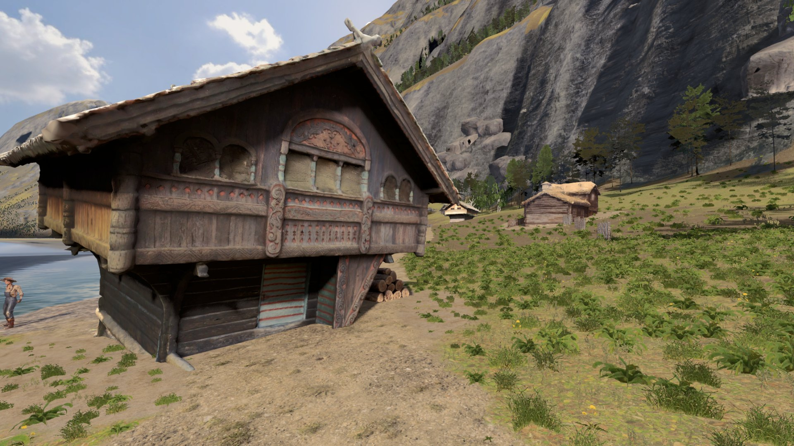

Working title. A non-violent open-world game for Android: explore, gather, build, trade and travel between regions that each look different. Engine: Godot 4.6 (Mobile renderer).

## What the APK is right now: a performance spike

The current build is a test scene, not the game. It answers one question: can a phone show the real Naeroyfjord valley at 60 fps (high-end) or 30 fps (floor) with the Mobile renderer? Budgets are in `docs/GDD.md` section 9.4.

What is in it:
- 12.8 x 12.8 km of real terrain (Kartverket 10 m model, 2.5 m round the village), drawn as chunked tiles with five levels of detail.
- Grey gneiss walls lit per pixel from the elevation data (every rib and chute shows even on far slopes): rock scans blended in all three directions at 90 m, 37 m and 12 m (and 3 m up close on Ultra), water streaks and moss that follow the real drainage lines, paler dry ridges, scree under the cliffs, meadow grass low, yellow-green turf and heather patches higher up, rock outcrops on knolls, snow by height, slope and shade, a darker wet band on sloping shores. The walls' shadows on the valley and the sky occlusion in gullies are baked from the elevation data.
- A Poly Haven cloud sky with a sun disc and glow round the sun, AgX tone mapping, glow, a colour grade fitted to the look-dev key frame, blue-grey haze that layers the far ridges, a near-white 30 degree sun with soft shadows.
- The fjord water mirrors the walls (two reflection probes), with calm ripples, chart-depth shallows and shore foam.
- Real village buildings: turf-roof timber houses, boathouses, boats and a wooden pier, with baked ambient occlusion.
- Up to 90 000 pines and spruces in forest stands with clearings below a tree line of about 500-650 m, drawn as impostors of scanned trees (8 directions, 2 heights) that sway in the wind and let the sun shine through; on Ultra the pines within 70 m are real tree meshes. Grass tufts, tall grass, ferns and shrubs round the player (out to 120 m on Ultra, ferns under the trees); a waterfall down the gully on the east wall that reads from the village.
- Soft contact shadows under animals, the player, Ingrid and every house; a reflection probe over the village street.
- Wildlife: does and deer grazing in view of the start, an elk and a moose at the forest edge, a fox and rabbits by the fields, wolves and a bear far off, an eagle over the walls and gulls over the fjord. They graze, wander and run from you; no combat.
- Ingrid, a villager standing idle by the jetty, and an explorer you control (idle, walk and run blend by speed; skin lit with light bleeding through).

| Spawn, Ultra | Village street, Ultra | Inside a pine stand, Ultra | Cliff, Ultra |
|---|---|---|---|
| 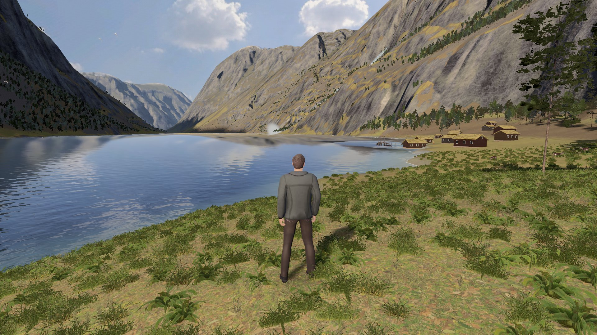 | 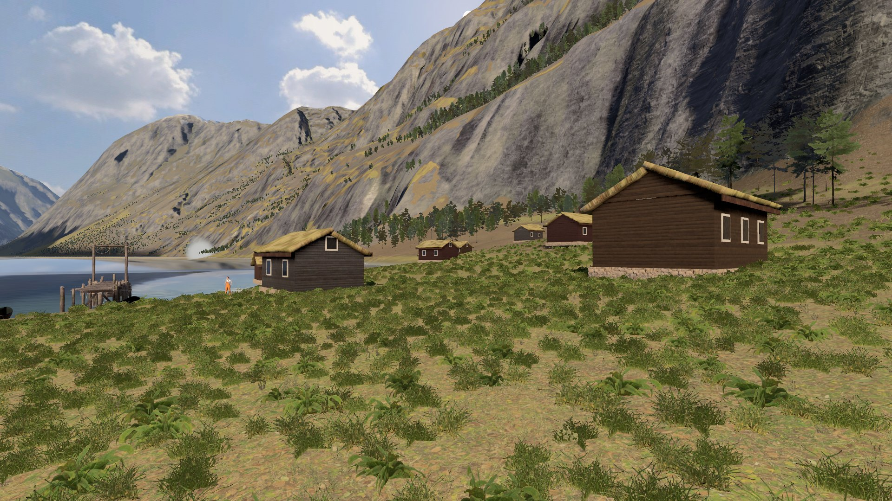 | 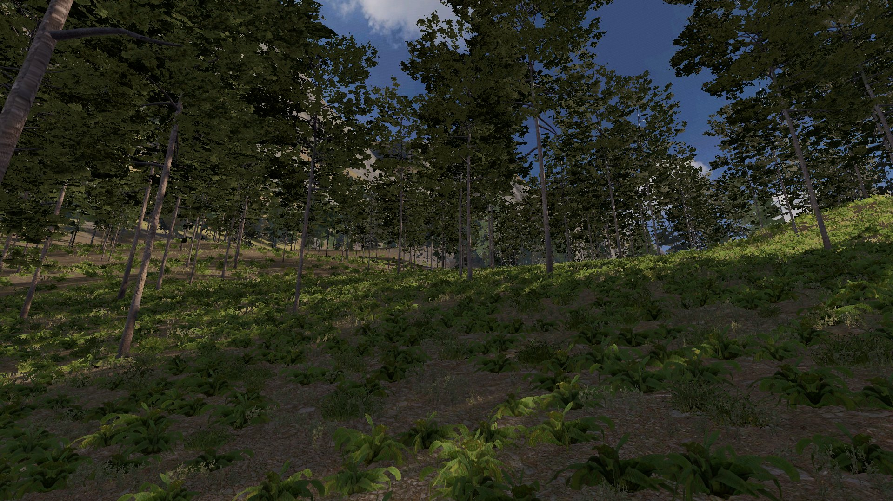 | 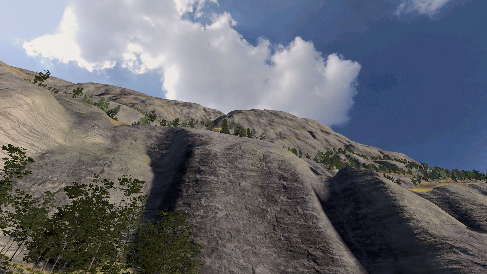 |
| **Deer on the meadow, Ultra** | **Forest slope, Ultra** | **Over the fjord, Ultra** | **Ingrid at the jetty, Ultra** |
| 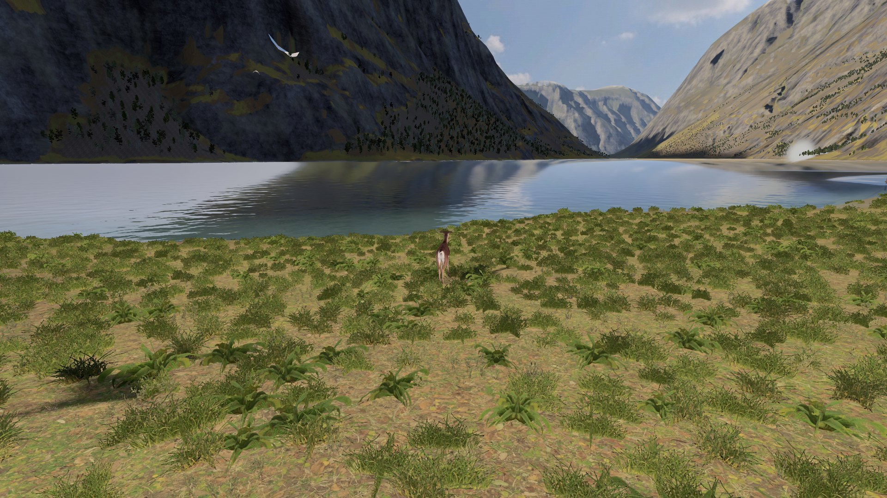 | 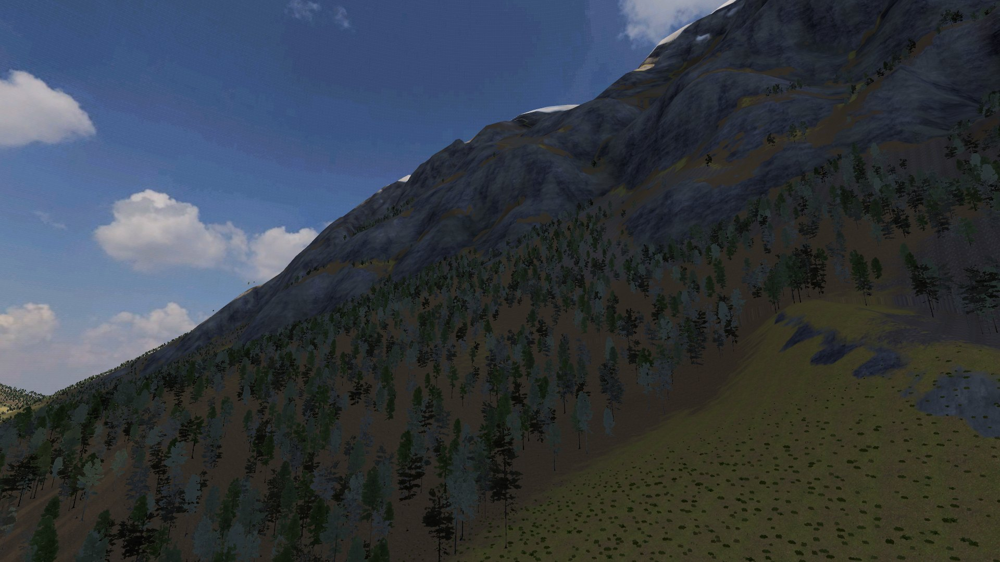 | 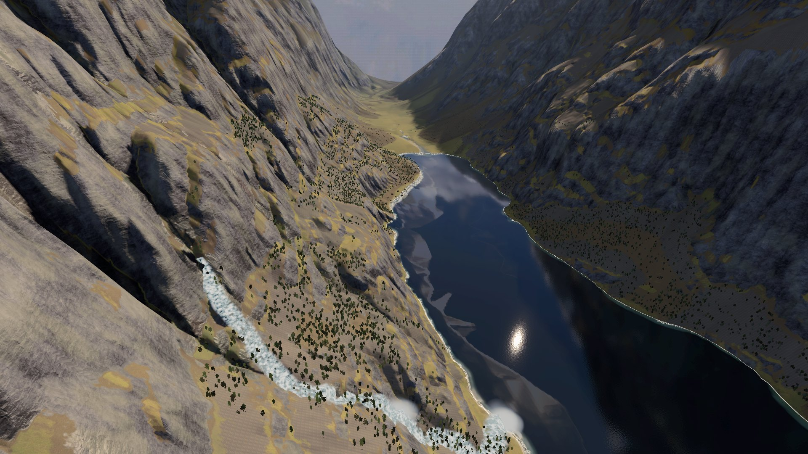 | 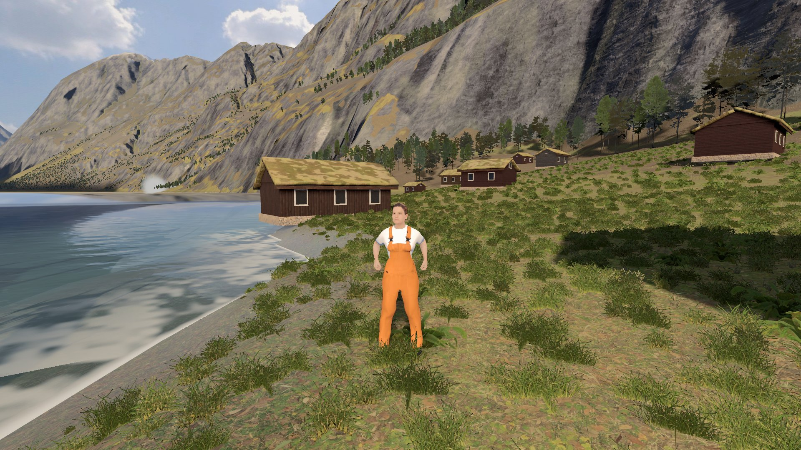 |
| **Spawn, Low** | **Inside a stand, Low** | **Before pass 2 (High)** | **Wall before pass 2: contour "wood grain"** |
| 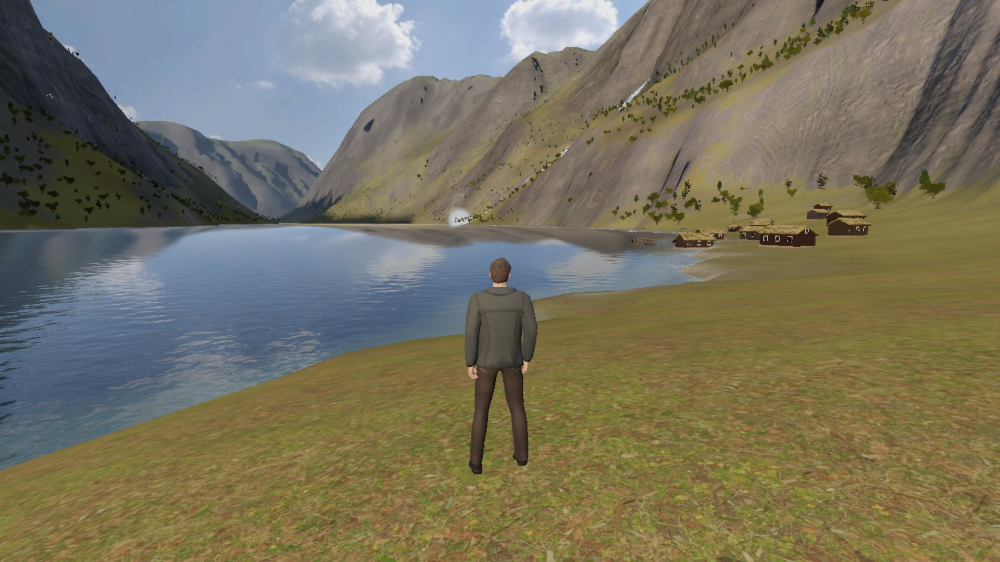 | 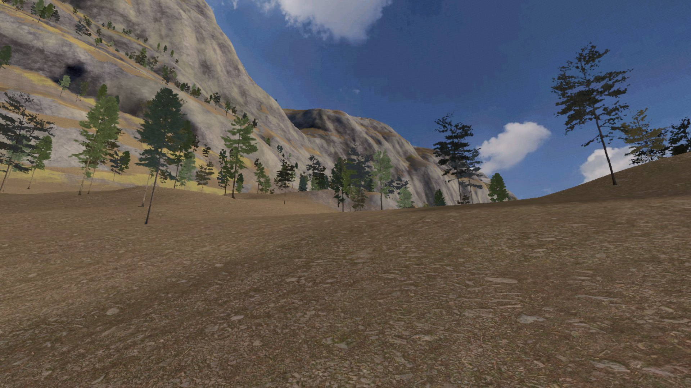 | 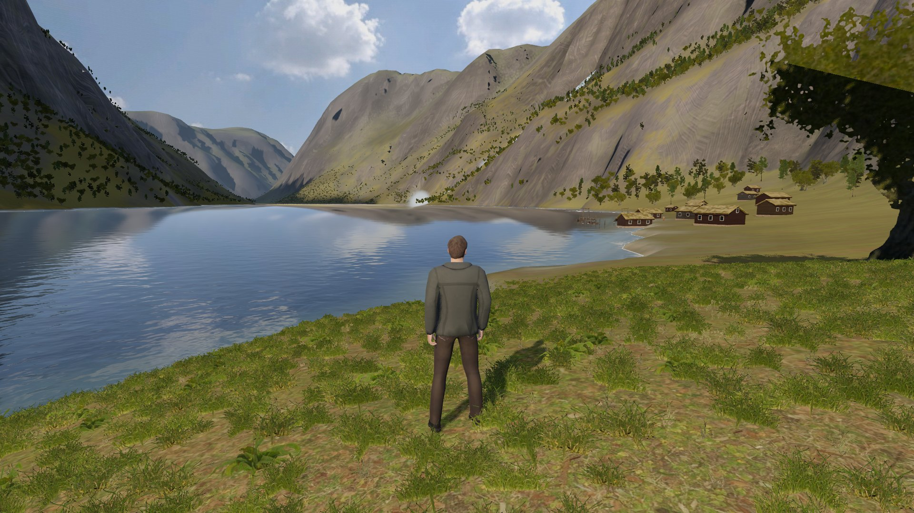 | 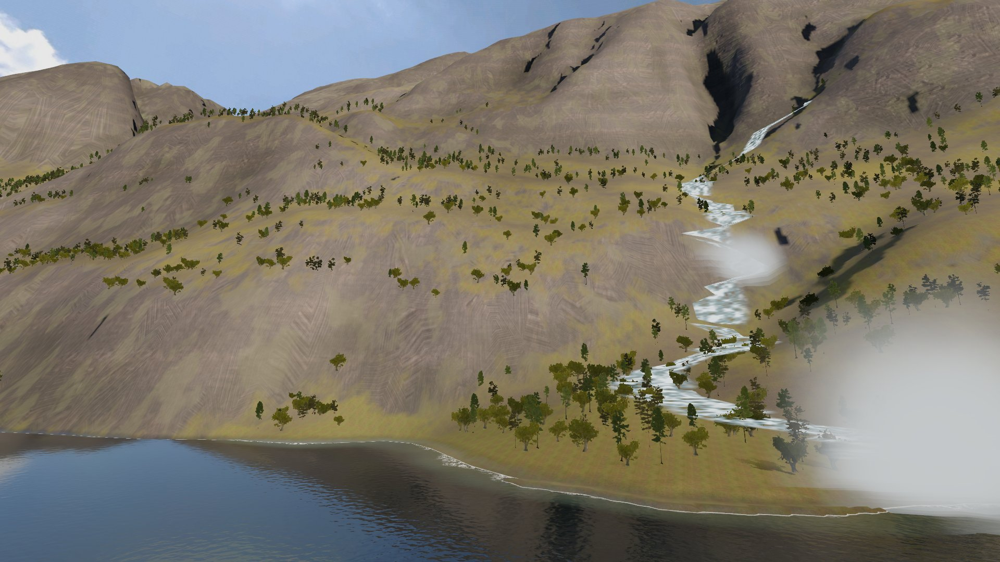 |

All screenshots come from the real Godot build (screenshot bot `tests/capture.tscn`, rendered on a laptop GPU). Laptop frame rates say nothing about phones; only the Bench numbers on the phone count.

## Beauty corner (pass 3)

One small area is built to final quality first, to prove the bar can be hit on a phone before the rest of the valley gets the same treatment: the spawn shore, Skarvik village and the cliff foot behind it (640 x 640 m), plus the cascade down the east wall.

- Houses are photogrammetry scans of real Norwegian buildings (a turf-roof log house from Norsk Folkemuseum and a carved storehouse from Evju bygdetun), with the scanned ground cut away and a normal map baked from the full scan.
- Baked light: the ground, houses, props and rocks of the corner carry a lightmap (Godot LightmapGI, baked in the editor by `tools/spike/bake_corner.sh`), so walls in shade get sky light and contact shadow under eaves, between logs and where a house meets the ground. The valley round it is in the bake, so the walls hide the sky as they really do.
- Ground: a worn dirt path from the spawn through the village to the jetty, gravel yards round the houses, a pebble shore and wet sand at the water line, blended into the meadow by their scanned heights. Grass stays off the path and the shore; dandelions and pink flowers in the meadow.
- Props: boats on the shore and at the jetty, woodpiles, skigard fences, two hjell drying racks. Rocks: boulders on the shore and in the meadow, talus and rock faces at wall scale on the cliff foot.
- Trees: birches round the village; on Ultra the near pines and spruces are real Scots pine and Norway spruce meshes.
- The cascade: white water down the real gully, faster where it is steeper, clear water on the run-out, splash and spray where it lands, mist, a plunge pool, dark wet rock. From the village only its mouth at the fjord is in view: the spur of the east wall hides the cascade (checked by line of sight on the elevation data).
- Characters: a scanned man as the player (idle, walk, run, sprint), a farmer as Ingrid.

| Village street, Ultra | House from 5 m, Ultra | Shore, Ultra | Cliff foot, Ultra |
|---|---|---|---|
|  | 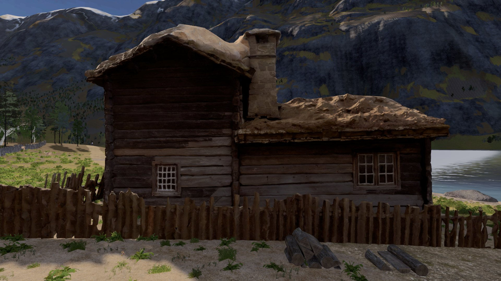 | 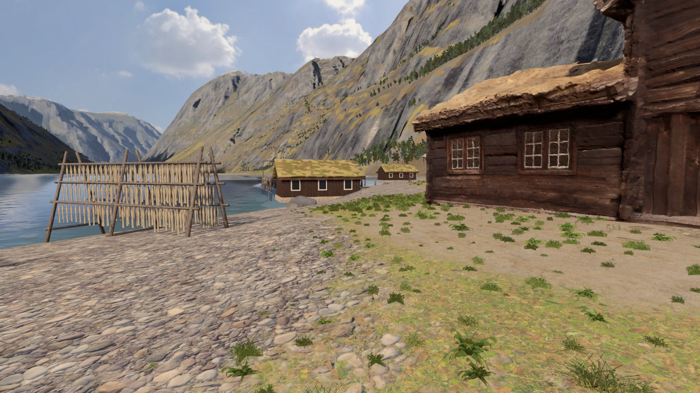 | 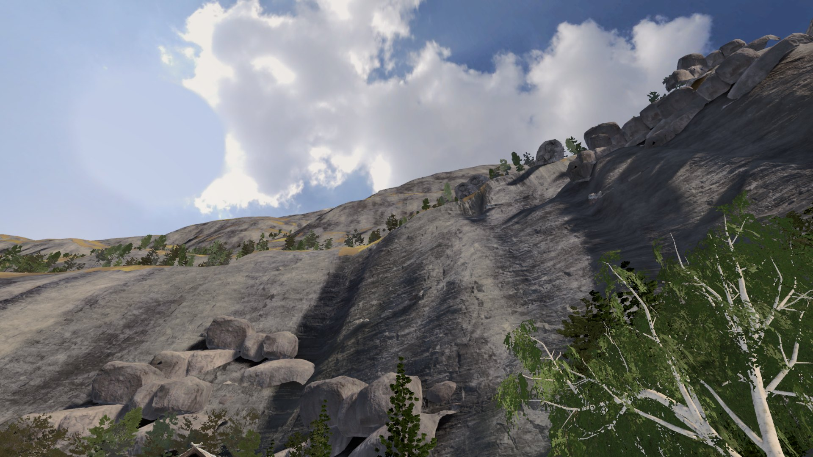 |
| **Cascade from the village, Ultra** | **Cascade close, Ultra** | **Spawn, Ultra** | **Spawn, High** |
| 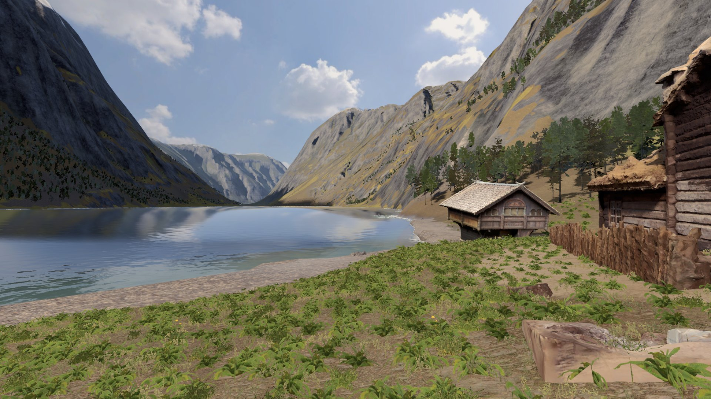 | 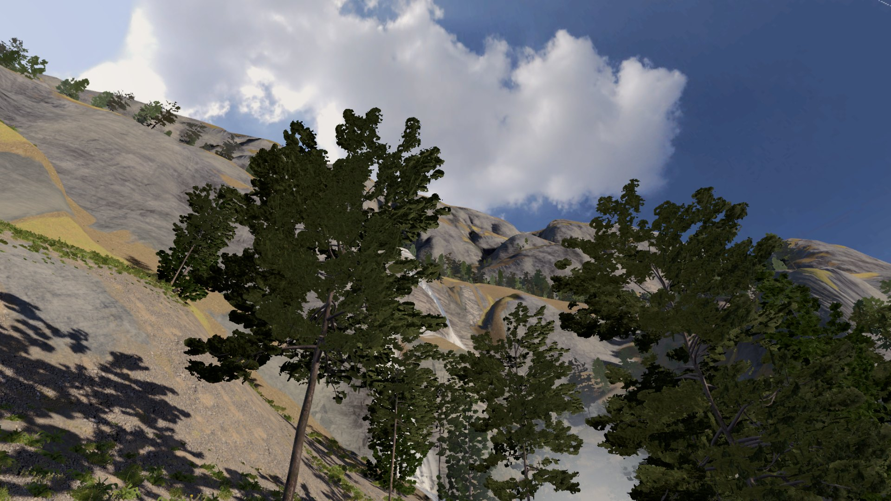 |  | 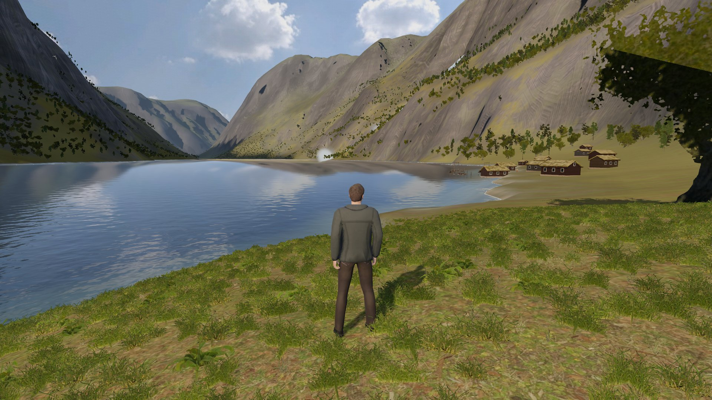 |

What still falls short (looked at in every shot above): the ground cover is still flat cards up close; the cliff wall itself is the smooth terrain surface, the rock pieces on it read as rounded boulders more than broken gneiss; the cascade close-up is a mid-distance view through trees and the cascade cannot be seen from the village; the two boathouses by the jetty are still the old procedural models; five storehouses share one scan (two mirrored).

## Install on a phone or tablet

1. On the device, tap [mwm-wayfarer.apk](https://github.com/Matswm86/mwm-wayfarer/releases/download/latest/mwm-wayfarer.apk) (or open the [latest release](https://github.com/Matswm86/mwm-wayfarer/releases/tag/latest)).
2. Open the file and allow "Install from this source" if Android asks.
3. If an older build will not update (signature mismatch), uninstall it first.

The APK runs on 64-bit phones and 32-bit tablets (arm64-v8a and armeabi-v7a). It is a release build signed with a CI key, for sideloading only. Landscape.

## Controls

- Left side of the screen: put a thumb down and drag to walk; push the stick all the way to run.
- Right side: drag to turn the camera round the player.
- Three-finger tap: hide or show the readout and buttons.

## Readout and buttons

Top left (always on): frames per second, p95 frame time over the last 300 frames, GPU render time (with its p95) and CPU time, draw calls, primitives, video memory and static memory, and a line with the vsync mode, anti-aliasing and frame cap. Android holds the frame rate at the display rate even with vsync off (120 fps on the owner's phone), so the GPU time is what shows the real headroom: under 16.7 ms is room for 60 fps.

| Button | What it does |
|---|---|
| Preset | Cycles Low / Medium / High / Ultra (table below). |
| Foam | Switches the depth-buffer shore foam on the water on or off, to compare its cost. |
| Forest | Cycles 20 % / 40 % / 60 % / 100 % of the 90 000 trees. |
| Bench 60 s | Flies the camera along a fixed 60 s path over the village and the fjord, then shows average fps, p95 ms, max ms, GPU average and p95 ms, average and max draw calls and max primitives for the current preset. |
| Bench all | Runs the same flight for Low, Medium, High and Ultra in a row (4 minutes) and shows one line per preset. |
| Hide result | Closes the bench result. |
| GPU parts | Measures what each feature of the current preset costs on this phone's GPU: at five views it renders the preset as is and with one switch off (anti-aliasing, sun shadows, shadow filter, tree shadows, ground cover, far clumps, pine meshes, forest, foam, glow, rock detail, render scale), alternating so heat drift cancels, and lists the ms each one costs. About 2 minutes. |
| VSync | Switches vsync off and on. With vsync on, the phone caps at its display rate (120 fps showed as 8.3 ms on every preset). Both bench buttons always run with vsync off and print the mode the driver reports, so the result shows the real frame time. |

At start the game renders every preset once behind a "Loading" note (about 2-3 s) so the shaders compile before you play, instead of stuttering the first time a preset or effect appears.

| Preset | Frame cap | Render scale | Anti-aliasing | Sun shadows | Glow | Rock detail | Forest | Ground cover | Shore foam | Wildlife |
|---|---|---|---|---|---|---|---|---|---|---|
| Low | display | 0.70 | none | off (baked terrain shadows only) | off | one scale, no scan normals | 20 % | off | off | 6 animals |
| Medium | display | 0.85 | MSAA 2x | 2 splits, 120 m, 2048 atlas | on | 2 scales + normals | 40 % | half | off | all 20 |
| High | 60 fps | 1.00 | MSAA 4x | 4 splits, 160 m, 4096 atlas | on | 2 scales + normals | 60 % (about 54 000, as pass 1) | full, 35 m | on | all 20 |
| Ultra | 60 fps | 0.90 | MSAA 4x | 4 splits, 240 m, 4096 atlas, soft filter + blur | on | + 3 m grain near | 100 % (90 000), pine and spruce meshes within 70 m | full to 35 m + clumps to 95 m | on | all 20 |

Laptop counts from the screenshot bot (1920 x 1080, visual pass 2): Low max 71 draws / 179k primitives over the eight shots, Ultra max 153 / 798k. Bench flight maxima: Low 100 draws / 205k, Medium 159 / 353k, High 172 / 504k, Ultra 178 / 786k. Laptop GPU time (RTX 3060, 1080p) on the flight: Low 6.0 ms, Medium 14.9, High 17.4, Ultra 18.7; only the phone numbers count.

Pass 3 (performance): High is capped at 60 fps (uncapped it jittered between 8, 17 and 25 ms frames on the 120 Hz screen); Ultra renders at 0.9 scale with a cheaper soft-shadow filter and fewer far clumps; heavy meshes (scanned houses, near trees, birches) cast their sun shadow with a light copy only; animals animate only near and in view; the near-tree gather runs on a worker thread. Laptop bench flight, GPU average / p95 before -> after (RTX 3060, rendering offscreen so the GPU keeps its clocks; laptop GPU is not a phone GPU): High 3.18 / 4.23 -> 2.98 / 4.62 ms, Ultra 5.20 / 7.78 -> 3.43 / 5.22 ms, with the beauty corner added. Bench lines now also show render CPU and physics ms.

To report a phone result: run Bench all and take a screenshot of the result box (the GPU column is the one that matters on Ultra), then GPU parts on Ultra.

## Repository

- `docs/BRIEF.md`: the owner brief. `docs/GDD.md`: game design. `docs/DESIGN.md`: look. `docs/mockups/`: look-dev renders. `docs/spike/`: spike screenshots.
- `project.godot`, `scenes/`, `scripts/`, `shaders/`, `tests/`: the Godot spike. Every tunable number is in `scripts/SpikeConfig.gd`.
- `tools/terrain/npz_to_godot.py`: bakes the terrain, forest, waterfall, village and bench path into `assets/terrain/`. Frame: scene (x, y, h) maps to Godot (x, h, -y), so Godot -Z looks down the fjord.
- `tools/terrain/copy_textures.py`: copies the CC0 textures into `assets/textures/`.
- Beauty corner: `tools/spike/export_corner_houses.py` (Blender: scans to game meshes), `tools/spike/pack_corner_textures.py` (path, gravel, pebble and sand layers), `tools/spike/build_corner.gd` (builds `scenes/BeautyCorner.tscn`), `tools/spike/bake_corner.sh` (bakes its lightmap through `addons/wf_bake`, `WF_CORNER_QUALITY=low|medium|high`). The screenshot bot's `CAPTURE_SET=beauty` takes the six corner views; `tests/profile.tscn` measures CPU and GPU per preset on the bench flight. `tools/spike/export_human.py`: exports the MakeHuman characters into `assets/models/`.
- `tools/spike/`: graphics-pass tools: `bake_terrain_light.py` (baked sun shadow and sky occlusion), `sky_to_ldr.py`, `export_village.py` + `village_textures.py`, `bake_tree_impostors.py` + `pack_tree_atlas.py`, `bake_ground_cards.py` + `pack_ground_cards.py`, `export_animals.py`, `vram_import.sh`; visual pass 2: `bake_terrain_detail.py` (per-texel normals, drainage, ridges), `pack_terrain_textures.py` (2K-4K rock and ground sets), `cube_to_png.py` (colour grade LUT), `export_rocks.py` (cliff rock stand-ins with LODs).
- `tools/art/`: Blender scripts that render the look-dev scenes. `tools/terrain/dem_to_game.py`: turns real elevation data into the fjord scene's terrain.

## Credits

- Fjord terrain and sea depth © Kartverket (CC BY 4.0), [kartverket.no](https://www.kartverket.no).
- Archipelago and canyon terrain: produced using Copernicus WorldDEM-30 © DLR e.V. 2010-2014 and © Airbus Defence and Space GmbH 2014-2018 provided under COPERNICUS by the European Union and ESA; all rights reserved.
- Textures, models, trees, plants and the sky from Poly Haven (CC0).
- Water foam and grass placement helpers ported from "stylized-components" by Christian Ortiz (Cortiz), MIT licence; full text in `shaders/LICENSE-stylized-components.txt`.
- Characters made with MakeHuman system assets and MPFB (CC0 assets and output) in earlier builds; now "Nathan Animated 003" by Renderpeople (player) and "Woman Farmer Walking Left Turn" by Natasha_Nabilah (Ingrid), both CC BY 4.0, animations Quaternius (CC0).
- Beauty corner houses: "Cabin 56, Norsk Folkemuseum" by Epic_Tree_Store and "Stabbur fra Evju bygdetun" by Kulturarv i Telemark fylkeskommune (Sketchfab, CC BY 4.0). Trees, boats, woodpiles, rocks and the rest of the corner: see `assets/models/corner/CREDITS.md` (PlantCatalog, lolipop_1707, donnichols, Pabooklas, apariciosilva3D, Seth7Santos: CC BY 4.0; Poly Haven: CC0).

### Animal models (Sketchfab)

Several are CC Attribution-NonCommercial: fine for this free build, but they must be replaced or licensed before any paid release. Full list: `assets/models/animals/CREDITS.md`, `assets/models/corner/CREDITS.md`.

| In game | Model | Author | Licence | Page |
|---|---|---|---|---|
| deer | DEER - Realistic 3D Model (DEMO FREE) | WildMesh_3D | CC Attribution-NonCommercial | https://sketchfab.com/3d-models/none-3997d669818c4e0d8c8bcafb0a1ae2ee |
| doe | Realistic Animated Doe 3D Model | WildMesh_3D | CC Attribution | https://sketchfab.com/3d-models/none-b6172618aa304473a4cf7b9246c0a218 |
| elk | Realistic Animated Elk 3D Model | WildMesh_3D | CC Attribution | https://sketchfab.com/3d-models/none-787834f9caa2474d9f1814b807c072d7 |
| moose | MOOSE - Realistic 3D Model (DEMO FREE) | WildMesh_3D | CC Attribution-NonCommercial | https://sketchfab.com/3d-models/none-0ee3d3f1e02746c89d6a5754dfd2ee67 |
| wolf | WOLF - Realistic 3D Model (DEMO FREE) | WildMesh_3D | CC Attribution-NonCommercial | https://sketchfab.com/3d-models/none-8840b859a566485c874a27b1731e1db8 |
| fox | FOX - Realistic 3D Model (DEMO FREE) | WildMesh_3D | CC Attribution-NonCommercial | https://sketchfab.com/3d-models/none-83b1b144712c43d282d90c2fb15ba450 |
| rabbit | RABBIT - Realistic 3D Model (DEMO FREE) | WildMesh_3D | CC Attribution-NonCommercial | https://sketchfab.com/3d-models/none-d70284ea0d7644988bdcd327c3ffb59a |
| bear | Realistic Animated Bear 3D Model | WildMesh_3D | CC Attribution | https://sketchfab.com/3d-models/none-bffc3c87d2d148ff8533e1cc8a11c9f1 |
| eagle | eagle | alexdubnoff (author match unverified) | CC Attribution-NonCommercial | https://sketchfab.com/3d-models/none-c2cd3a0995b949c2a978125d17dfe8af |
| gull | Seagull | Dayvable (author match unverified) | CC Attribution | https://sketchfab.com/3d-models/none-dc42ffc81c86480e9e7f7752fa134174 |

Sources and licence notes: `assets/_raw/dem/SOURCE.md`, `assets/_raw/dem/cop30/SOURCE.md`, `assets/textures/SOURCE.md`, `assets/sky/SOURCE.md`, `assets/models/SOURCE.md`, `assets/models/village/SOURCE.md`, `assets/models/trees/SOURCE.md`, `assets/models/ground/SOURCE.md`, `assets/models/animals/CREDITS.md`, `assets/models/corner/CREDITS.md`.
